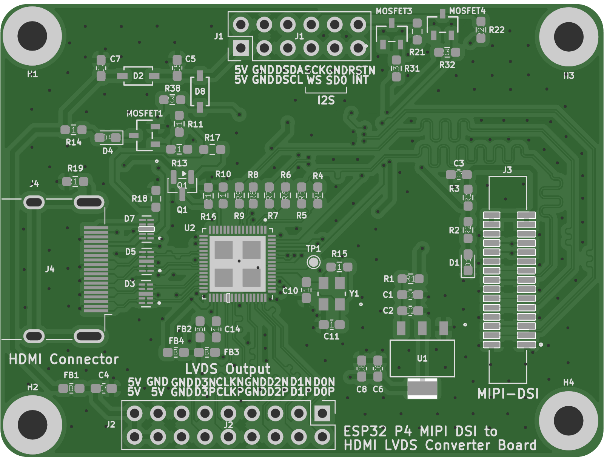

# KCCI PCB Design Portfolio

PCB design work by **Bramantio Ananda** (Electrical Engineering, Institut Teknologi Bandung) during the
**KCCI Overseas Professional Technical Workforce Training Program – Electronics track**.
All boards were designed in **KiCad 10** from schematic capture through routing, DRC, and fabrication output.

| Project | Layers | Size | Highlights |
|---|---|---|---|
| [**ESP32-P4 MIPI-DSI → HDMI / LVDS Bridge**](hdmi-lvds-bridge/) | 4 | 65.4 × 49.2 mm | LT8912B bridge, 100 Ω controlled-impedance pairs, length-matched DSI / TMDS / LVDS, double-sided assembly |
| [**ATmega128-16A Minimum System**](atmega128-minimum-system/) | 2 | 71.6 × 46.3 mm | TQFP-64 MCU, 5 V linear regulator, ISP header, all ports broken out |
| [**Conveyor Sorter Shield** (group project)](conveyor-shield-kel1/) | 2 | — | STM32 Nucleo-F411RE shield with buck converter and actuator connectors |
| [**Signal-Integrity Analyses**](signal-integrity/) | — | — | Crosstalk, backplane channel, and CTLE studies (MATLAB, Serial Link Designer, SPICE) |

<p align="center">
  
  
</p>

## Repository layout

Each board folder follows the same structure:

```
<project>/
├── kicad/            KiCad project (.kicad_pro / .kicad_sch / .kicad_pcb) + project-local libraries
├── fabrication/
│   ├── gerber/       Gerber + Excellon drill files (ready to upload to a PCB fab)
│   └── assembly/     BOM (.csv) and pick-and-place (.pos)
└── docs/             Schematic PDF and board renders
```

## Opening the projects

1. Install [KiCad 10](https://www.kicad.org/download/) (files were saved with KiCad 10.0.7; older versions cannot open them).
2. Open `<project>/kicad/*.kicad_pro`.
   Custom symbols and footprints are included in each project's `kicad/library` folder and registered in the
   project-local `sym-lib-table` / `fp-lib-table`, so no extra library setup is needed.

## Author

Bramantio Ananda · [Portfolio](https://bramantio-ananda-portfolio.netlify.app/) · [GitHub @23Senna](https://github.com/23Senna)
