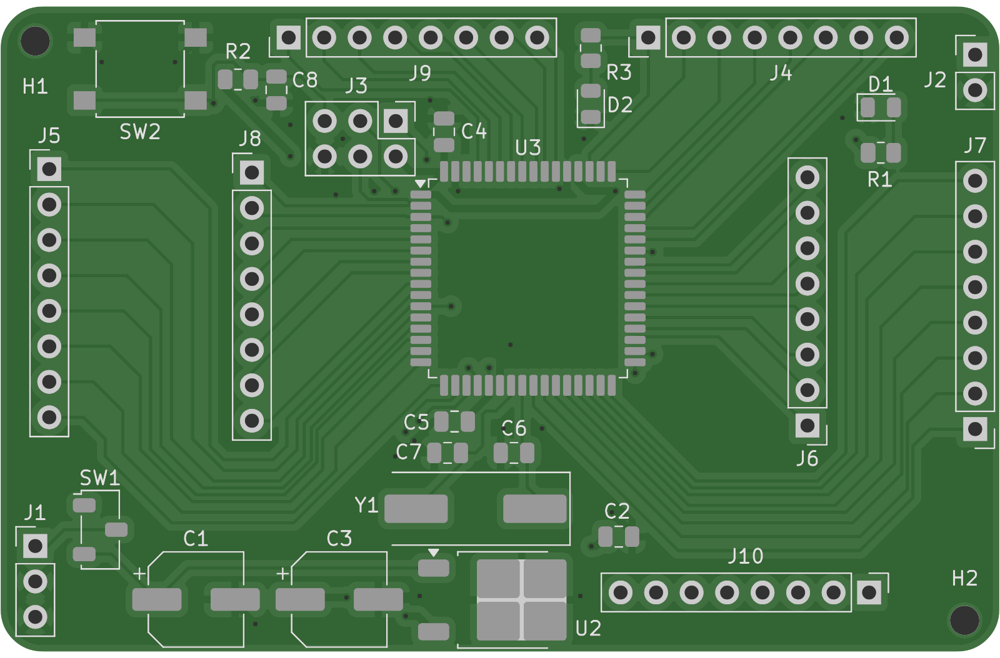
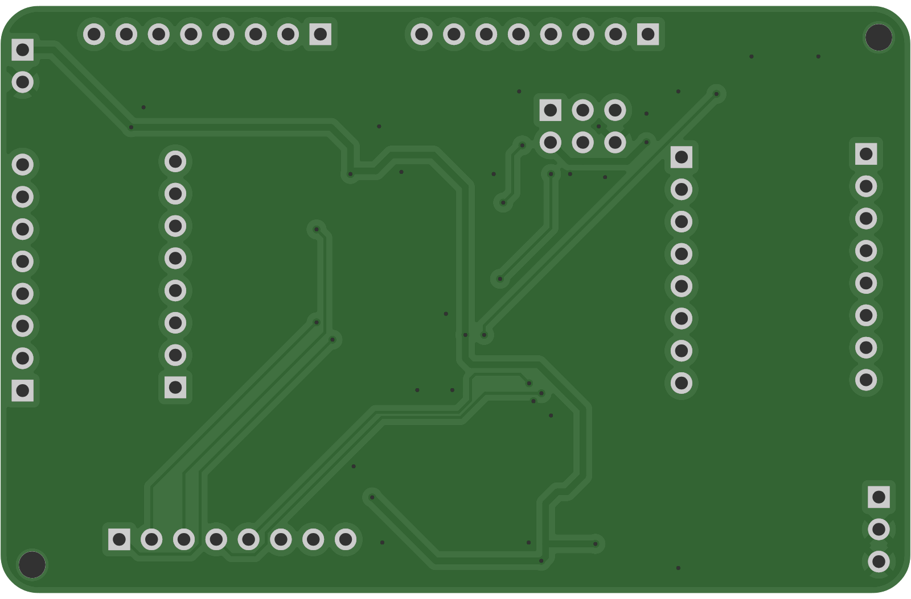

# ATmega128-16A Minimum System

A 2-layer development board for the **Microchip ATmega128-16A** (TQFP-64): on-board 5 V regulation, a 16 MHz clock, an
AVR-ISP programming header, and every I/O port broken out to 2.54 mm headers.

  
  

Top and bottom renders generated from the fabrication Gerbers.

## Specifications

| Item | Value |
|---|---|
| Board size | 71.6 × 46.3 mm, 1.6 mm FR-4 |
| Layers | 2 (F.Cu / B.Cu) |
| Components | 28 placements, all on the top side |
| Tracks | 0.2 mm signal, 0.5 mm power |
| Vias | 0.6 mm pad / 0.3 mm drill |
| Copper-to-edge clearance | 0.5 mm |

## Circuit blocks

The schematic is split into three sections:

- **Power & regulator:** L7805 (TO-252) linear regulator with 47 µF input/output bulk capacitors, a slide switch, and an
  indicator LED.
- **ATmega128-16A core:** 16 MHz HC49 crystal with 22 pF load capacitors, four 0.1 µF decoupling capacitors, and a reset
  push-button with a 10 kΩ pull-up.
- **ISP & support:** 6-pin AVR-ISP header (PDI = PE0, PDO = PE1, SCK = PB1, RESET), seven 1×8 port headers, a second LED,
  and mounting holes.

## Files

| Path | Contents |
|---|---|
| [`kicad/`](kicad/) | KiCad 10 project (standard KiCad libraries only) |
| [`fabrication/gerber/`](fabrication/gerber/) | Gerbers and PTH / NPTH drill files |
| [`fabrication/assembly/`](fabrication/assembly/) | BOM (`ATMega128-BOM.csv`) and pick-and-place (`ATMega128-all.pos`) |
| [`docs/images/`](docs/images/) | Board renders |

**Status:** design complete, DRC-clean in KiCad 10.
