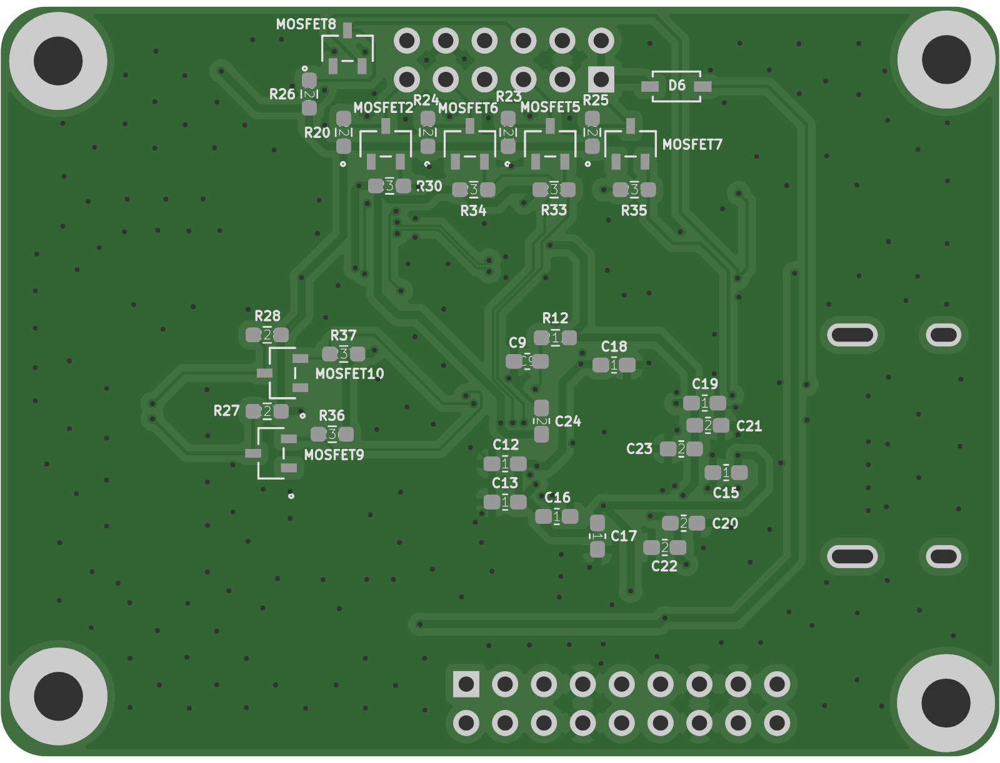
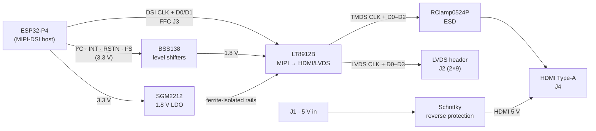

# ESP32-P4 MIPI-DSI → HDMI / LVDS Bridge

A 4-layer converter board that takes the **2-lane MIPI-DSI** display output of an **ESP32-P4** and drives either an
**HDMI** monitor or an **LVDS** panel, using the **Lontium LT8912B** bridge IC.

  
  

Top and bottom renders generated from the fabrication Gerbers.

## Block diagram

## Specifications

| Item | Value |
|---|---|
| Board size | 65.4 × 49.2 mm, 1.6 mm FR-4 |
| Stack-up | 4 layers – **F.Cu signal / In1 GND / In2 GND / B.Cu signal** (JLCPCB JLC04161H-7628, prepreg 0.21 mm, εr ≈ 4.4) |
| Components | 96 placements – 61 top, 35 bottom (double-sided assembly) |
| Differential pairs | 100 Ω: 0.1278 mm width / 0.127 mm gap (from JLCPCB impedance calculator) |
| Signal / power tracks | 0.2 mm (0.15 mm at QFN pins) / 0.5 mm |
| Vias | 0.6 mm pad / 0.3 mm drill |
| Min. clearance · copper-to-edge | 0.127 mm · 0.5 mm |

### Length matching (custom DRC rules in `ESP32-HDMI-LVDS.kicad_dru`)

| Interface | Pairs | Target length | Intra-pair skew |
|---|---|---|---|
| MIPI-DSI (J3 → LT8912B) | CLK, D0, D1 | 71.74 mm (±0.05) | ≤ 0.07 mm |
| HDMI TMDS (LT8912B → J4) | CLK, D0, D1, D2 | 12.76 mm (±0.14) | ≤ 0.10 mm |
| LVDS (LT8912B → J2) | CLK, D0–D3 | 18.70 mm (±0.04) | ≤ 0.04 mm |

All high-speed pairs run over the solid inner ground planes.

## Design notes

- **Power:** an SGM2212 LDO derives 1.8 V for the LT8912B from the ESP32-P4's 3.3 V rail, and each analog/digital/PLL rail
  is isolated with a 220 Ω @ 100 MHz ferrite bead plus 10 µF / 0.1 µF decoupling. 5 V enters on J1 through a 1N5819
  Schottky (reverse-polarity protection) and supplies the HDMI +5 V / DDC side.
  The decoupling capacitors sit on the bottom side directly under U2.
- **Clock and PLL:** 25 MHz crystal (10 pF load caps, 1 MΩ bias), 6.04 kΩ R6K bias resistor, and a 2.2 nF HDMI-PLL
  loop-filter capacitor on PLL_LPF (pin 35).
- **Control signals:** BSS138 bidirectional shifters translate I²C, INT, RSTN, and I²S between the ESP32-P4 (3.3 V) and the
  LT8912B (1.8 V). HDMI DDC is shifted to the 5 V HDMI side, and HPD is level-shifted through an MMBT3904.
- **Protection:** RClamp0524P TVS arrays on all TMDS lines at the HDMI connector.

## Files

| Path | Contents |
|---|---|
| [`kicad/`](kicad/) | KiCad 10 project, custom DRC rules, project-local symbol / footprint / 3D libraries |
| [`fabrication/gerber/`](fabrication/gerber/) | Gerbers (F/In1/In2/B copper, mask, paste, silk, edge) and PTH / NPTH drill files |
| [`fabrication/assembly/`](fabrication/assembly/) | BOM (`ESP32-HDMI-LVDS-BOM.csv`) and pick-and-place (`ESP32-HDMI-LVDS-all.pos`) |
| [`docs/`](docs/) | Schematic PDF (exported 2026-10-15) and board renders |

**Status:** design complete, DRC-clean in KiCad 10.
